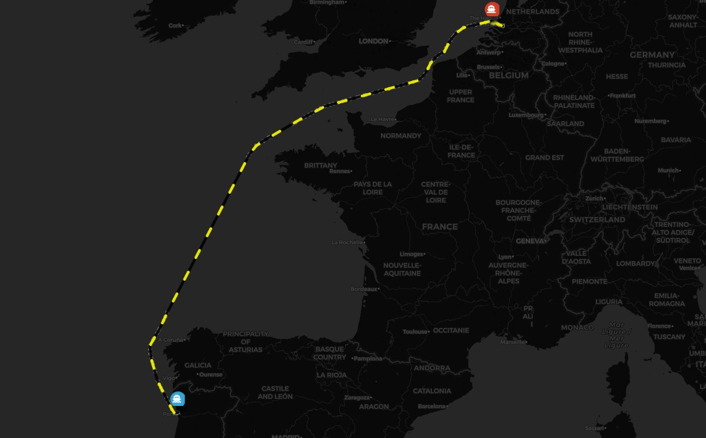

# Vessel Route Dashboard

**An interactive maritime dashboard that combines ship-tracking data with weather along each route.**

[**Live demo**](https://marine-dashboard.streamlit.app) · [Portfolio](https://salmana1259.github.io/#vessel) · Built by [Salman Arif](https://www.linkedin.com/in/salmanarif1259)



## What it does

- Pick a vessel (by IMO number) and one of its routes from the sidebar.
- See the vessel's details, its route on an interactive map, and KPIs for the trip.
- Explore speed over time, speed distribution and the weather conditions met along the route.

## How it was built

Built during my data science internship at Techma Zone, as part of a senior-led project on predicting alternative vessel routes. I wrote the code for this dashboard.

1. **Data collection:** vessel positions (AIS: speed, course, heading, departure and destination) gathered through APIs and web scraping, joined with weather observations for each position.
2. **Processing:** cleaning and transformation with Pandas into one dataset of 1,116 position records across two vessels and six routes (`Marine_routes.csv`).
3. **Visualisation:** route maps with Folium (pre-rendered HTML), charts with Plotly, Matplotlib and Seaborn, served through Streamlit.

## Run locally

```bash
pip install -r requirements.txt
streamlit run fin_demo.py
```

## Tech

Python · Pandas · Plotly · Folium · Matplotlib · Seaborn · Streamlit
